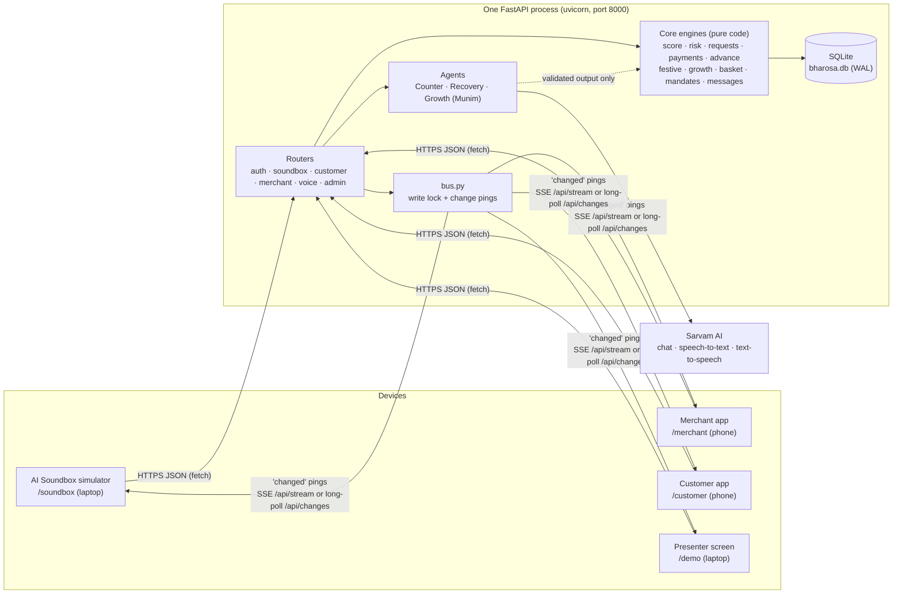
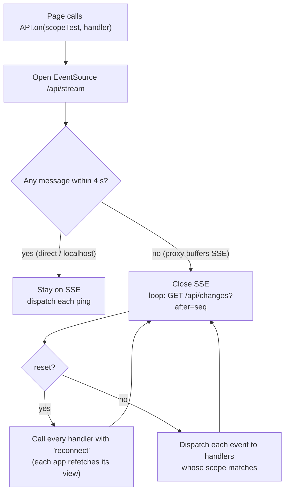
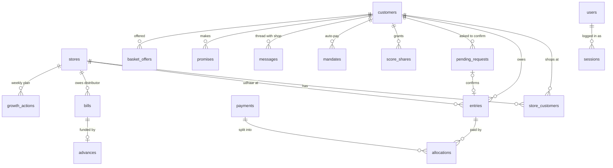
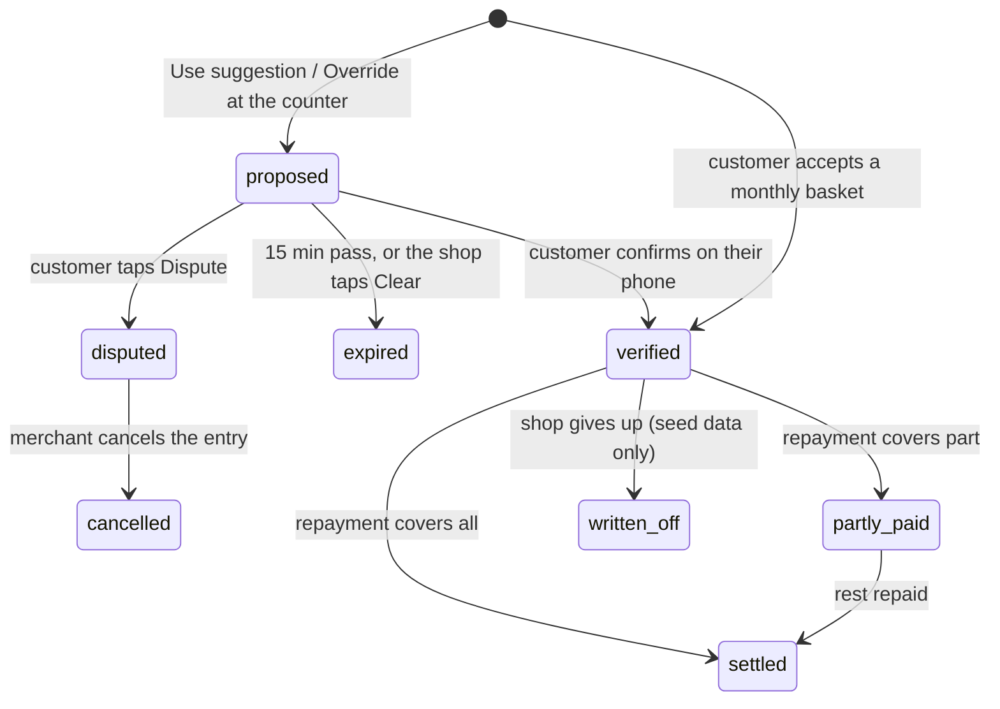
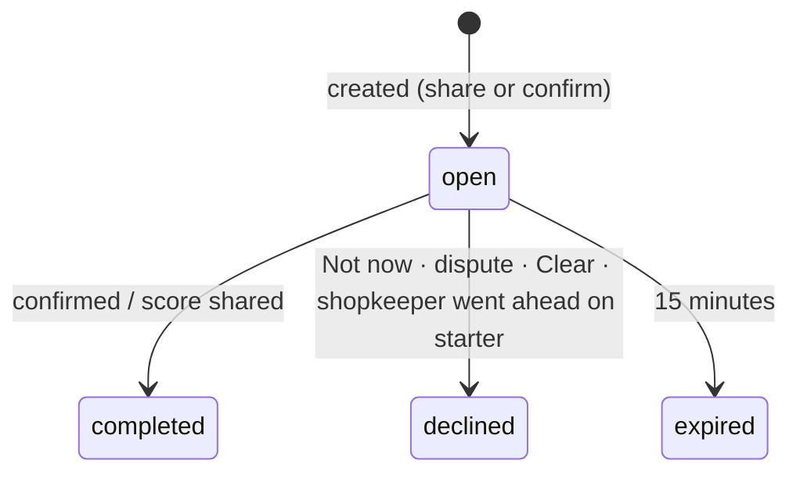
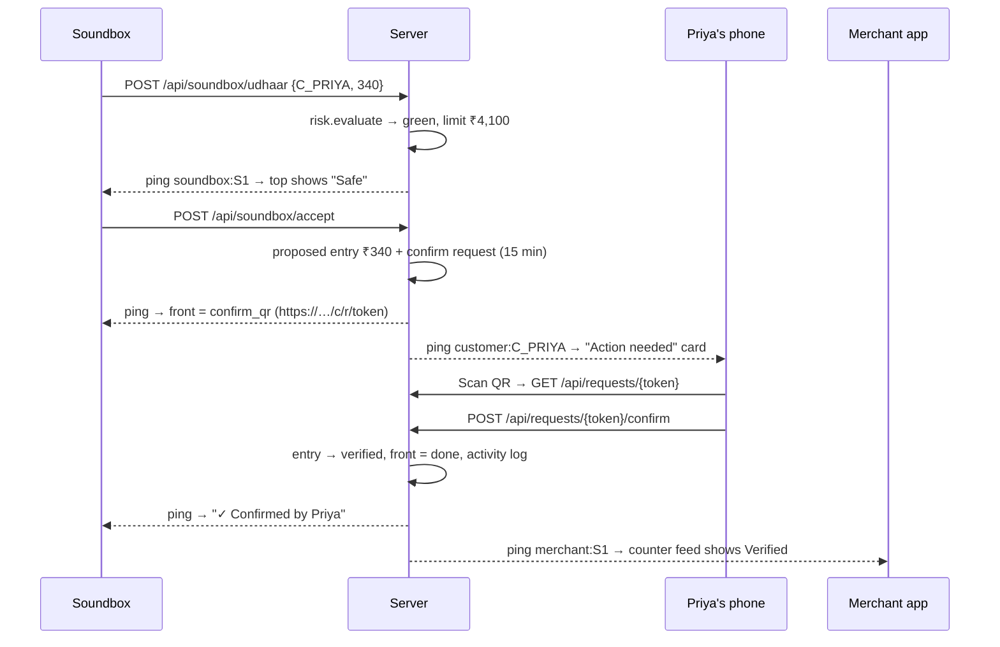
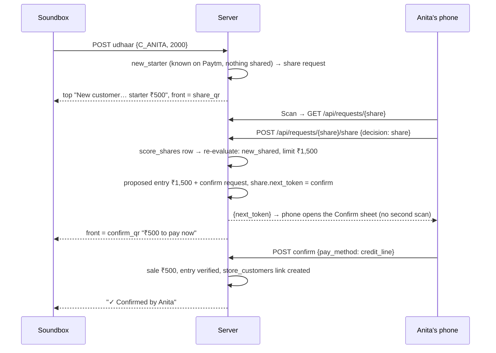
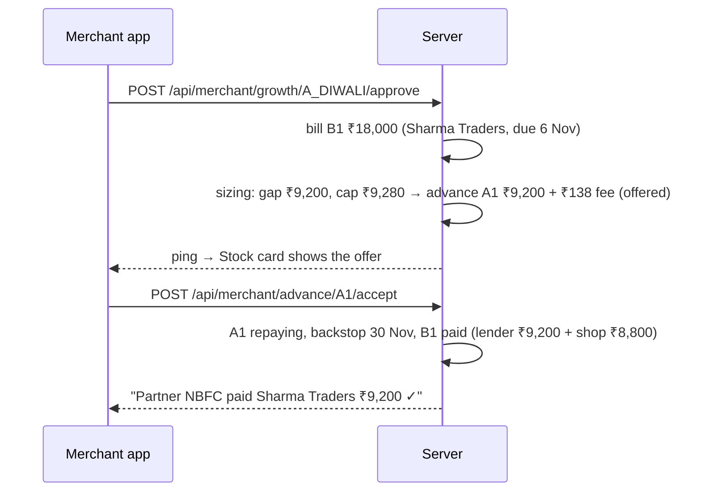
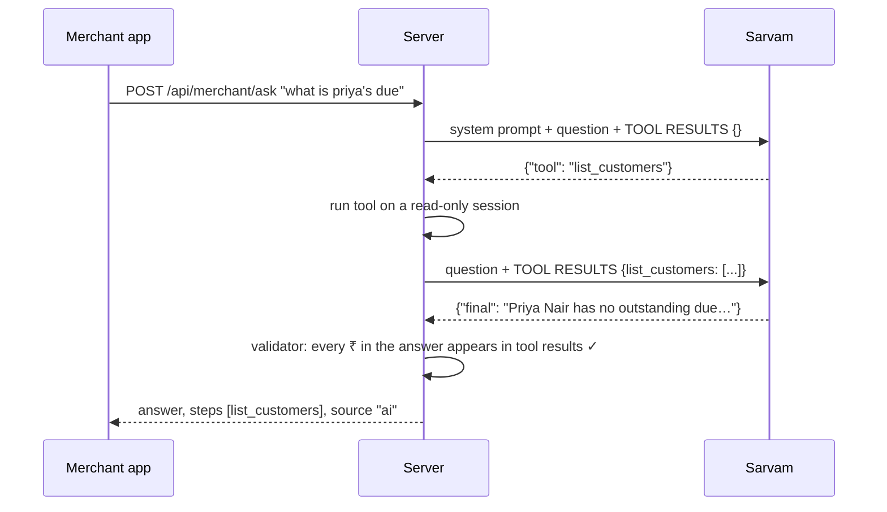
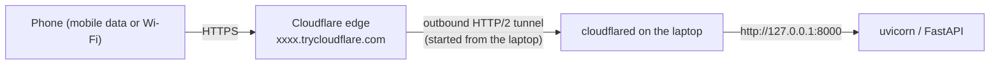

# Bharosa: technical deep dive

This document explains how the Bharosa prototype is built and how its parts work together. It covers the architecture, the design choices behind it, the data model, every business engine, the AI layer, the five apps, and each demo flow from the first tap to the database and back. It ends with security, testing, known limitations and a configuration reference.
5c5626b1-64c4-4caa-b933-ffbad3cabdff
It describes the code as it is in this repository. Every number, rule and state below comes from the source files named next to it. For the product story and the pitch, read [`bharosa-explained.md`](bharosa-explained.md). For the original specification, read [`bharosa-arch-v2.md`](bharosa-arch-v2.md).

---

## Contents

1. [The system at a glance](#1-the-system-at-a-glance)
2. [Design choices](#2-design-choices)
3. [Repository map](#3-repository-map)
4. [Runtime model: one process, one lock, one bus](#4-runtime-model-one-process-one-lock-one-bus)
5. [Real-time updates](#5-real-time-updates)
6. [Logins, sessions and roles](#6-logins-sessions-and-roles)
7. [Data model](#7-data-model)
8. [Core engines](#8-core-engines)
9. [The AI layer](#9-the-ai-layer)
10. [The five apps (frontend)](#10-the-five-apps-frontend)
11. [End-to-end flows](#11-end-to-end-flows)
12. [Who refreshes when: the interaction matrix](#12-who-refreshes-when-the-interaction-matrix)
13. [Running on real phones](#13-running-on-real-phones)
14. [Security and privacy](#14-security-and-privacy)
15. [Testing](#15-testing)
16. [Known limitations and the production path](#16-known-limitations-and-the-production-path)
17. [Configuration reference](#17-configuration-reference)
18. [API reference](#18-api-reference)

---

## 1. The system at a glance

Bharosa is a single Python web server. It serves five browser apps, a JSON API and a live-update channel, and stores everything in one SQLite file. An optional AI layer calls Sarvam AI. With AI off, every feature still works on rules and templates.



There are three kinds of traffic:

| Traffic | Direction | What it carries |
|---|---|---|
| **Commands** (`POST /api/...`) | App → server | An action: ask for udhaar, confirm, pay, approve |
| **Views** (`GET /api/...`) | App → server | The app's whole screen as JSON, computed fresh from the database |
| **Pings** (`/api/stream` or `/api/changes`) | Server → app | Only *which* areas changed, e.g. `["merchant:S1", "customer:C_RAMESH"]`. Never any data |

Every screen follows the same cycle: send a command, receive a ping, refetch the view. No app keeps its own copy of business state.

---

## 2. Design choices

Each choice below names the alternative that was rejected and why.

| Choice | Alternative | Why this one |
|---|---|---|
| **One process, one SQLite file** | Postgres, Redis, a queue, microservices | A demo has to start on any laptop with `pip install` and reset in under a second. SQLite in WAL mode handles a handful of phones easily. |
| **One global write lock** (`bus.LOCK`) | Row locks, optimistic concurrency | Money rules such as "confirm only once", "split 20% until repaid" and "one active mandate" become correct by construction. Throughput doesn't matter at demo scale. |
| **Pings carry no data** | Push the new state over the socket | One stream serves every user without leaking one user's data to another. Each app refetches through its own authenticated endpoint, so privacy rules live in one place: the view functions. |
| **Views computed on read; the score is never stored** | Cache scores and totals | Nothing can drift. The score, limits and totals always match the entries table. With about 100 rows, recomputing is microseconds (the guardrail reports its own `ms`). |
| **"AI proposes, code decides"** | Let the model decide limits or amounts | An LLM can't be audited or reproduced. Code decides every rupee: score, limit, split, advance. AI only words text or reads intent, and a validator checks every AI output against facts the code computed. |
| **Rules first, AI second, template last** | AI first | Common inputs ("Ramesh 340", "salary 1 tareekh") are handled in microseconds with no cost or network. AI handles only what the rules can't. If AI fails or times out (8 s), a template answers. |
| **The QR bridge for confirmation** | The merchant types the amount and it counts | Udhaar is only real once the *customer* confirms in their own app. That stops fake entries, which matters because entries back the Stock Advance. |
| **A fixed demo date** (`DEMO_DATE`) | The real clock | Every number in the pitch (19 days overdue, Diwali in 8 days) stays true on stage. `now()` combines the fixed date with the real time of day, so 15-minute expiries still work. |
| **Integer rupees and `Fraction` maths** | Floats | No rounding drift. Limits round *down* to ₹50 (`floor50`) and fees round half up. |
| **Alpine.js pages, no build step** | React/Vite | Each app is one HTML file and one JS file. No Node and no bundler, so a judge can read it. |
| **No mock data in the frontend** | Hard-coded demo names and amounts | `tests/test_no_mock_ui.py` fails if a JS or HTML file contains a demo name or a `₹<digit>` amount. Everything on screen comes from the API, so the demo is the real system. |
| **Long-poll fallback for live updates** | SSE only | Cloudflare quick tunnels buffer SSE, so phones never received pings. Pages now switch to long-polling after 4 s of silence (see [§5](#5-real-time-updates)). |

---

## 3. Repository map

```
app/
  main.py            FastAPI app: lifespan (create tables, seed on first start), routers, /static, page routes
  config.py          Settings from .env (pydantic-settings); today()/now() use the fixed demo date
  db.py              SQLite engine (WAL, foreign keys), session(), create_all(), rebuild()
  models.py          22 SQLModel tables
  seed.py            The demo world; build() rebuilds every table
  auth.py            OTP, magic links, session cookies, role dependencies, admin key
  bus.py             Global write lock, tx(), change pings, SSE subscribers, long-poll log
  errors.py          EventError(message, status): core code raises it, main.py turns it into JSON
  voice.py           One short spoken line per event (translate → validate → queue for the Soundbox)
  core/
    score.py         Bharosa Score from repayment history (live, never stored)
    risk.py          Safe limit and the Safe / Caution / High risk guardrail
    requests.py      The counter and the QR bridge: Soundbox state, share/confirm requests, expiry, disputes
    payments.py      Sales, FIFO repayments, the 20% lender split
    advance.py       Stock Advance sizing, offer, accept, decline
    festive.py       The Diwali stock plan from last year's festive week
    growth.py        The weekly growth plan (3 actions) and what approving each one does
    basket.py        Monthly basket prediction, offer, accept, delivery
    mandates.py      Salary-week auto-pay schedule
    messages.py      Customer replies → intent, promise, buttons
    activity.py      The activity log shown on the presenter screen
    money.py         inr(), floor_to(), round_half_up()
  ai/sarvam.py       Thin Sarvam client: chat_json, text_to_speech, speech_to_text (None on any failure)
  agents/
    counter.py       Counter Agent: shopkeeper text → (customer, amount)
    recovery.py      Recovery Agent: reminder drafts and reply understanding
    growth_agent.py  Growth Agent: plan wording and Ask Munim
    common.py        rupee_figures(): finds every ₹ amount in a text (used by every validator)
  api/               auth · soundbox · customer · merchant · voice · admin routes
static/
  shared/            tokens.css, base.css, api.js (fetch + live updates), format.js (money, dates, QR, gauge)
  soundbox/ merchant/ customer/ demo/ guide/ home/ overview/ presentation/
  vendor/            alpine.min.js, qrcode.min.js, html5-qrcode.min.js
tests/               52 tests: the spec's contracts
scripts/             sarvam_smoke.py (one real AI call), build_pdf.py (slides → PDF)
tasks.py             run · seed · test · smoke · pdf (Windows has no make)
```

Dependencies (`requirements.txt`): FastAPI, uvicorn, SQLModel, pydantic, pydantic-settings, python-dotenv, sse-starlette, httpx, python-multipart and pytest. Exact versions are pinned in `requirements.lock.txt`.

---

## 4. Runtime model: one process, one lock, one bus

### 4.1 Startup (`app/main.py`)

1. The `lifespan` hook calls `db.create_all()`. If the `stores` table is empty, it runs `seed.build()`. That only happens on the first start, so restarting the server keeps your data.
2. Routers are registered in this order: auth, soundbox, customer, merchant, voice, admin.
3. `/static` serves files. `/`, `/merchant`, `/customer`, `/soundbox`, `/demo`, `/overview` and `/presentation` each return that app's `index.html` with `Cache-Control: no-store`, so a phone always gets the latest page.
4. `/c/r/{token}` also returns the customer app. The page reads the token from its own URL. That's how a QR scanned with a phone's camera app opens the right request.
5. One exception handler turns `EventError(message, status)` into `{"detail": message}` with that status. Core modules raise `EventError` and never import FastAPI.

### 4.2 The write path (`app/bus.py`)

Every endpoint that changes state runs its work inside `bus.tx()`:

```python
async with bus.tx() as t:      # 1. take the global asyncio lock
    ...core logic on t.s...    # 2. one SQLAlchemy session, one transaction
    t.touch("merchant:S1", "customer:C_RAMESH", "soundbox:S1")   # 3. note what changed
# 4. commit (or roll back on any exception), release the lock
# 5. publish {"type": "changed", "scopes": [... + "activity"]}
# 6. publish any queued spoken lines {"type": "speak", ...}
```

What this guarantees:
- **Serial writes.** Only one transaction runs at a time, so two phones confirming the same request can't both succeed. The second sees `status != "open"` and gets 409.
- **All or nothing.** A confirm that records a sale, verifies the entry, updates the Soundbox and logs activity either happens completely or not at all.
- **Pings after commit.** A ping is only sent once the data is saved, so a refetch triggered by it always sees the new state.

Most `GET` view endpoints (merchant home, Udhaar Book, Soundbox state) also run inside `bus.tx()`. Reads can write: `requests.expire_stale()` expires stale requests lazily whenever someone looks. There is no background clock.

### 4.3 Scopes

A scope names one screen's data:

| Scope | Who listens | Touched when |
|---|---|---|
| `merchant:S1` | Merchant app | Anything changes at the shop |
| `soundbox:S1` | Soundbox | The counter display changes: a guardrail result, QR, confirmation, payment, spoken line |
| `customer:<id>` | That customer's app | Their requests, dues, messages, basket or mandate change |
| `activity` | Presenter screen | Added to every ping automatically |

The presenter screen listens to every ping. Each other app filters pings by its own scope (see [§12](#12-who-refreshes-when-the-interaction-matrix)).

---

## 5. Real-time updates

### 5.1 Server side

`bus.publish(msg)` does three things:
1. Gives the message the next sequence number `_seq` and appends it to `_recent`, which keeps the last 500 messages.
2. Puts the message on every SSE subscriber's queue (maximum 200 per queue; a full queue drops that subscriber).
3. Long-poll waiters wake up because they also subscribe for the length of their wait.

Two endpoints deliver the same messages:

| Endpoint | How it works |
|---|---|
| `GET /api/stream` | Server-Sent Events via `sse-starlette`. Sends `{"type":"hello"}` first, then each message as it arrives, and a keep-alive comment every 15 s. |
| `GET /api/changes?after=N&wait=20` | Long-poll. Returns immediately if there are messages newer than `N`. Otherwise waits up to `wait` seconds (capped at 25). The response is `{seq, reset, events}`. |

`reset: true` means the client can't catch up: it's the first call, the server restarted (`after > seq`), or the client fell more than 500 messages behind. The client then refetches everything.

### 5.2 Client side (`static/shared/api.js`)



- `dispatch(msg)` calls each handler whose scope test matches any scope in the ping.
- On SSE reconnect (`onopen`) and on long-poll `reset`, every handler is called once with `{type: "reconnect"}`, so screens resync after a dropped connection or a server restart.
- If a long-poll request fails, the client waits 2 s and retries.

**Why the fallback exists:** a Cloudflare quick tunnel buffers `text/event-stream` responses. Testing showed nothing arrived until about 64 KB had piled up, not even the first `hello`. On `localhost` everything worked. Long-poll responses are ordinary, complete JSON responses, which the tunnel passes straight through. Measured through the tunnel, a ping reached the client 0.19 s after the change was committed.

---

## 6. Logins, sessions and roles

`app/auth.py` defines four kinds of caller.

| Role | How it proves itself | Dependency | Scope of access |
|---|---|---|---|
| Merchant | Phone `9000000001` + OTP | `auth.merchant` (cookie `bh_merchant`) | Their own store only |
| Customer | Phone + OTP, or a one-time login QR | `auth.customer` (cookie `bh_customer`) | Their own requests, dues and messages |
| Admin (presenter) | `X-Admin-Key` header = `ADMIN_KEY` | `auth.admin` | Reset, login QRs, activity for all stores |
| Soundbox | Nothing; fixed to store S1 | none | The counter of S1 |

How sessions work:
- **OTP.** `start_otp` only checks that the number is registered for that app. No SMS is sent. `verify_otp` compares against `DEMO_OTP` (`123456`).
- **Session.** A random 24-byte token is stored in `sessions` with a 12-hour expiry and set as an `HttpOnly`, `SameSite=Lax` cookie. The cookie is `Secure` when `PUBLIC_BASE_URL` starts with `https`.
- **Separate cookies per app.** The merchant and customer apps use different cookie names, so one browser can be logged in as both.
- **Login QR (magic link).** `POST /api/admin/magic` creates a 10-minute, single-use code. Its URL is `PUBLIC_BASE_URL/api/auth/magic/<code>`. Opening it sets the customer cookie and redirects (303) to `/customer`. A second use returns 410. The presenter screen regenerates the QRs every 9 minutes.
- **Logout.** `POST /api/auth/logout?app=customer|merchant` deletes the session row and clears the cookie. The customer app's **Log out** button calls it, then reloads `/customer` so no state from the previous customer survives.
- **Secure cookies on HTTPS.** Once `PUBLIC_BASE_URL` is an `https://` tunnel address, session cookies are only sent over HTTPS. Logging in on `http://localhost` stops working after that; use the tunnel address everywhere.

---

## 7. Data model

### 7.1 Tables



| Table | Purpose | Key columns |
|---|---|---|
| `stores` | Shops | `starter_limit` (₹500), `due_days` (30), `cash_available_by_bill_due` (₹8,800), `upi_sales_today`, `voice_lang` (kn-IN), `is_network` |
| `customers` | People | `lang` (en-IN, hi-IN, kn-IN), `loginable` (has the app) |
| `store_customers` | Who shops where | Composite key; `credit_balance` (overpayment) |
| `entries` | Each udhaar given | `amount`, `paid`, `state`, `source` (counter, basket, seed), `due_date`, `settled_at`, `items`, `band`, `tags`, `override`, `device_id`, `integrity_flag`, `dispute_reason` |
| `payments` | Money received | `method` (upi, credit_line, cash, autopay), `purpose` (sale or repayment), `merchant_share`, `lender_share` |
| `allocations` | Which payment paid which entry | `payment_id`, `entry_id`, `amount` |
| `pending_requests` | The QR bridge | `token`, `kind` (share or confirm), `status`, `credit_now`, `collect_now`, `entry_id`, `expires_at`, `next_token` |
| `score_shares` | Portable Trust consent | `granted_at`, `revoked_at` |
| `mandates` | Salary-week auto-pay | `cap`, `collection_day`, `status` |
| `messages` | Shop ↔ customer threads | `direction` (out or in), `source` (template, ai, customer), `meta` (intent, promise, buttons, escalate), `read` |
| `promises` | "I'll pay ₹X on date Y" | `amount`, `date` |
| `catalogue` | Products | `sku`, `category`, `price` |
| `festive_profiles` | Last year's festive data | `profile` JSON |
| `bills` | Distributor orders | `B1`: amount, due date, `paid_by_lender`, `paid_by_store` |
| `advances` | Stock Advance | `A1`: amount, fee, `total_due`, `repaid`, `split_rate`, `state`, `backstop_date` |
| `growth_actions` | The weekly plan | `action_id`, `facts`, `impact`, `rank`, `title`, `why`, `state`, `source` |
| `basket_offers` | Monthly basket | `items`, `value`, `state`, `entry_id` |
| `users`, `sessions`, `magic_links` | Logins | |
| `activity` | Event log | `kind`, `text`, `source` (rule, ai, template) |
| `soundbox_state` | The counter display | One JSON row per store: `top`, `front`, `pending`, `feed` |

### 7.2 Modelling decisions

- **The `NET` pseudo-store.** Anita's history at other Paytm shops is stored under one store with id `NET`, named "Other Paytm shops". The score and the exposure cap read it. No merchant endpoint ever returns its name, entries or amounts. A merchant only sees a score band, a limit and the tag "New · Paytm network".
- **Entries are the single source of truth.** The score, limits, outstanding totals, overdue days, the advance's eligible book and the growth plan are all computed from `entries` when read.
- **Allocations make repayments auditable.** Each repayment is split across entries oldest first, and each piece is recorded.
- **JSON columns** (`items`, `tags`, `facts`, `meta`, `soundbox_state.state`) keep the prototype flexible where the shape changes per feature.
- **Fixed ids `B1` and `A1`.** The demo has one Diwali bill and one advance.

### 7.3 Time

`today()` always returns `DEMO_DATE` (31 Oct 2026). `now()` is that date with the real time of day. Overdue days, due dates, next collection dates and the Diwali countdown all use `today()`. Request expiry (15 minutes) and session expiry (12 hours) use `now()`.

---

## 8. Core engines

All of these are plain functions over a session. They raise `EventError` for rule violations and log to `activity`. None of them call AI.

### 8.1 Udhaar entry lifecycle



| State | Counts as owed | Score effect |
|---|---|---|
| proposed | No | None |
| verified, partly_paid | Yes (`amount − paid`) | −2 per day overdue (worst entry) |
| settled | No | +15 if `settled_at` ≤ `due_date`, otherwise −10 |
| expired, disputed, cancelled | No | None |
| written_off | No | −60 |

The due date is the creation date plus 30 days (`store.due_days`). An entry is overdue when it's open and `today > due_date`.

### 8.2 Bharosa Score (`core/score.py`)

```
score = clamp(300, 900,  600 + 15 × on_time − 10 × late − 2 × max_overdue_days − 60 × written_off)
```

The score covers the customer's entries at **every** store, including `NET`. It returns a breakdown, one line per term, which the customer app shows under "How it's calculated".

| Score | Band |
|---|---|
| ≥ 800 | Excellent |
| 700–799 | Strong |
| 550–699 | Good |
| < 550 | Building |

Demo values after Reset:

| Customer | Calculation | Score |
|---|---|---|
| Priya | 600 + 12×15 | 780 Strong |
| Ramesh | 600 + 8×15 − 2×10 − 19×2 | 662 Good |
| Vikram | 600 + 2×15 − 5×10 − 41×2 − 60 | 438 Building |
| Anita | 600 + 12×15 − 10 | 770 Strong |
| Regulars | 600 + 6×15 | 690 Good |

### 8.3 Safe limit and the guardrail (`core/risk.py`)

`evaluate(store, customer, amount)` returns a `Guardrail`: score, base, safe limit, band, credit now, collect now, kind, reasons and tags.

1. `base = 500 + (score − 300) / 600 × 4,500`, so a score of 300 gives ₹500 and 900 gives ₹5,000.
2. `exposure_room = base − everything the customer owes across all shops`.
3. The kind of customer decides the safe limit:

| Kind | Condition | Safe limit |
|---|---|---|
| `brand_new` | No entries anywhere | Starter limit, ₹500 |
| `new_starter` | New to this shop, known elsewhere, score not shared | Starter limit, ₹500. `needs_share` is true and the Soundbox shows a share QR |
| `new_shared` | New to this shop, score shared | min(floor50(40% × base), ₹1,500, exposure_room). Tag "New · Paytm network" |
| `existing` | Has entries here | min(base × multiplier − owed here, exposure_room) |

Multiplier by worst overdue at this shop: 0 days ×1, 1–14 days ×0.75, 15–30 days ×0.6, more than 30 days ×0.

4. The limit is floored to ₹50 and clamped to ₹0–₹5,000.
5. Band: **green (Safe)** if amount ≤ safe limit; **red (High risk)** if the safe limit is ₹0; otherwise **amber (Caution)**, which gives the safe limit on credit and collects the rest now.

The `reasons` list ("Score 662 → base ₹3,215", "₹1,700 overdue for 19 days → ×0.6", "Already owes ₹1,700 here") is shown to the merchant under "Why this limit?". It never names another shop or shows its amounts.

Demo results:

| Request | Working | Result |
|---|---|---|
| Priya ₹340 | 4,100 × 1 − 0 | Green, limit ₹4,100 |
| Ramesh ₹340 | 3,215 × 0.6 − 1,700 = 229 → ₹200 | Amber: ₹200 credit + ₹140 now |
| Vikram ₹340 | × 0 | Red: collect ₹340 |
| Anita ₹2,000, not shared | Starter | Amber: ₹500 credit + ₹1,500 now |
| Anita ₹2,000, shared | min(1,600, 1,500, 3,425) | Amber: ₹1,500 credit + ₹500 now |

### 8.4 The counter and the QR bridge (`core/requests.py`)

The Soundbox state is one JSON row per store:
- `top`: the shopkeeper-facing guardrail result
- `front`: the customer-facing screen, in one of the modes `idle`, `share_qr`, `confirm_qr`, `pay_full`, `done`
- `pending`: the decision waiting for **Use suggestion** or **Override**
- `feed`: the last 5 counter decisions, shown on the merchant home screen

Step by step:

1. **`udhaar(customer, amount)`**, after the shopkeeper taps a preset or types text:
   - Validates ₹1–₹50,000 and expires stale requests.
   - Evaluates the guardrail and writes `top` and `pending`.
   - If `needs_share`, creates a **share** request and sets `front = share_qr`.
2. **`accept(override)`**, when the shopkeeper taps **Use suggestion** or **Override**:
   - If a share request is still open, declines it, so the starter limit applies.
   - Calls `_start_confirm`, which re-evaluates the guardrail. With override, the credit is the full amount.
   - If the credit is ₹0 (red): `front = pay_full`. A plain UPI QR is shown and no entry is created.
   - Otherwise: creates a **proposed** entry and a **confirm** request with `credit_now` and `collect_now`, and sets `front = confirm_qr` with the QR URL `PUBLIC_BASE_URL/c/r/<token>`.
3. **`share(token, decision)`**, when the customer taps **Share** or **Not now**:
   - **Share** inserts a `score_shares` row.
   - Either way, `_start_confirm` runs immediately and the share request stores `next_token`.
   - The phone opens the confirm sheet without a second scan, and the Soundbox switches to the new confirm QR.
4. **`confirm(token, pay_method, device_id)`**, when the customer confirms:
   - Rejects the call if the request belongs to someone else (403), is expired (410), or was already answered (409).
   - If `collect_now > 0`, it requires `upi` or `credit_line` and records a **sale** payment. A sale never touches dues.
   - Sets the entry to **verified** and stores the device id.
   - Creates the `store_customers` link if this is a new customer.
   - Runs the integrity check, sets `front = done` ("✓ Confirmed by Ramesh") and logs activity.
5. **`dispute(token, reason)`** sets the entry to **disputed** and the request to declined, and shows "Disputed by …" on the Soundbox. The merchant can then **cancel** the entry.
6. **`clear()`** withdraws whatever QR is showing. Its request becomes declined and its proposed entry expires, so a customer can't confirm something the shop cancelled.
7. **`expire_stale()`** expires open requests older than 15 minutes, along with their proposed entries, and resets the Soundbox front. It runs lazily on reads.

**Integrity check.** If the same `device_id` confirmed an entry for a *different* customer at this shop within 24 hours, the new entry gets `integrity_flag = true`. Flagged entries are left out of the Stock Advance's eligible book, which stops one phone from inflating the book.



### 8.5 Payments and the split (`core/payments.py`)

- **`record_sale`** stores the "pay now" part of a purchase with purpose `sale`. It is never allocated to dues and never split.
- **`repay(amount, method)`** stores a payment with purpose `repayment`:
  - Pays open entries **oldest first**. Each piece becomes an `allocation`. Each entry becomes `settled` (with `settled_at`) or `partly_paid`.
  - Anything left over goes to `store_customers.credit_balance`.
  - Then runs the split.
- **`_split`** applies only when the method is `upi` or `autopay` **and** the shop has an advance in state `repaying`:
  - `lender_share = min(round_half_up(amount × 20%), total_due − repaid)` and `merchant_share = amount − lender_share`.
  - Once `repaid ≥ total_due`, the advance becomes `closed`.
  - Example: Ramesh pays ₹500 → ₹400 to the shop, ₹100 to the Partner NBFC.

### 8.6 Diwali stock plan (`core/festive.py`)

From the seeded festive profile (last year's Diwali week compared with a normal week):

| Category | Normal week | Diwali week | Uplift | Counted? | Extra sales |
|---|---|---|---|---|---|
| Sweets & dry fruits | 4,000 | 9,600 | 2.4× | Yes | 5,600 |
| Oil & ghee | 9,000 | 16,200 | 1.8× | Yes | 7,200 |
| Snacks | 8,000 | 13,600 | 1.7× | Yes | 5,600 |
| Puja items | 4,500 | 13,500 | 3.0× | Yes | 9,000 |
| Staples | 30,000 | 36,000 | 1.2× | No (below 1.3×) | — |

- Expected extra sales: **₹27,400**.
- Order = round to ₹100 of (27,400 × (1 − 18% margin) × 0.8 safety) = **₹18,000** from Sharma Traders, bill due Fri 6 Nov.
- Overall uplift shown to the merchant = 88,900 ÷ 55,500 = **1.6×**. This figure is only displayed.

### 8.7 Stock Advance (`core/advance.py`)

- **Gap** = bill − cash available by the due date = 18,000 − 8,800 = **₹9,200**.
- **Eligible book** = open, unflagged entries at the shop from customers scoring ≥ 550. That's Ramesh's ₹1,700 plus the regulars' ₹21,500 = ₹23,200. Vikram (438) is excluded.
- **Cap** = 40% of the eligible book = ₹9,280.
- **Advance** = min(gap, cap, bill) = **₹9,200**. **Fee** = 1.5% = **₹138**. Total due ₹9,338.
- **States:** `offered` → `repaying` (merchant accepts) → `closed` (repaid through the split). From `offered` it can also go to `declined`.
- **On accept:** the bill is marked paid, with ₹9,200 from the lender and ₹8,800 from the shop. The activity log shows "Partner NBFC paid Sharma Traders ₹9,200 ✓". `backstop_date` is set to 30 days later. In production this is where a real disbursement to the distributor would happen; in the prototype only the record changes.

### 8.8 Growth plan (`core/growth.py`)

`compute()` builds three actions from live data. Each one has `facts`, an `impact` figure, a template `title` and a template `why`:

| Rank | Action | Impact | What approving does |
|---|---|---|---|
| 1 | `A_DIWALI` "Stock up for Diwali" | ₹27,400 expected extra sales | Creates bill B1 and, if there's a cash gap, offers advance A1 |
| 2 | `A_REMIND` "Remind 2 overdue customers" | ₹4,300 overdue | Drafts and sends a reminder to each overdue customer, using their live dues |
| 3 | `A_BASKET` "Offer Priya her monthly basket" | ₹1,850 | Sends a basket offer if it still fits within her safe limit |

- **Generation.** `generate()` runs at seed time and on Reset. With AI on, Reset then asks the Growth Agent to reword titles and reasons only.
- **Outcomes.** `view()` works out each action's outcome when read. Examples: "Stock Advance offered: ₹9,200", "Sent to 2 · 1 replied · 1 promise", "Priya accepted ✓ · deliver from Orders". An action counts as **done** once its follow-up finishes.
- **Ranking.** The rank follows the order in which the actions are built, which matches impact order for this data. The code doesn't sort them.

### 8.9 Monthly basket (`core/basket.py`)

- **Prediction.** It looks at the customer's purchases in the first 7 days of each of the last 3 months. An item is kept if it appears in at least 2 of those months, with the median quantity at today's price. For Priya this gives 8 items worth **₹1,850**.
- **Offer.** Only sent if the basket value is within the customer's current safe limit.
- **Accept.** Creates a **verified** entry (source `basket`, band green). No QR is needed, because the customer accepted in their own app.
- **States:** `offered` → `accepted` → `delivered` (merchant taps **Mark delivered**), or `offered` → `declined`.

### 8.10 Salary-week auto-pay (`core/mandates.py`)

- **Defaults:** cap ₹3,000 per month, collection on the 2nd. The cap must be ₹500–₹15,000 and the day 1–28. Only one active mandate is allowed per customer per shop.
- **Schedule:** next collection is Mon 2 Nov, with a notice on Sun 1 Nov. The amount is min(verified dues, cap).
- In the prototype the mandate is recorded and its schedule displayed, but no collection ever runs.

### 8.11 Replies, promises and buttons (`core/messages.py`)

When a customer replies in Messages:
1. The inbound message is stored.
2. The Recovery Agent interprets it (see [§9.3](#93-the-agents)).
3. If the reply is a **promise**, a `promises` row is stored, e.g. "Ramesh promised ₹1,900 on 01 Nov". ₹1,900 is his ₹1,700 plus the ₹200 credit from the amber sale.
4. Buttons are attached to the shop's answer:
   - **Set up salary-week auto-pay**, if suggested and no mandate exists.
   - **Pay now**, if dues > 0 and the reply isn't a dispute.
5. A dispute or a hardship reply also logs "needs your attention" for the merchant.

---

## 9. The AI layer

### 9.1 Principle: AI proposes, code decides

| Decided by code, never AI | Where AI helps (always validated) |
|---|---|
| Bharosa Score, safe limit, band | Understanding free shopkeeper text ("Ramesh ko 340 ka udhaar") |
| Credit / collect split at the counter | Writing reminder messages in the customer's language |
| Payments, FIFO allocation, the 20% split | Understanding customer replies that the keyword rules miss |
| Stock Advance size, fee and eligibility | Wording the growth plan |
| Growth plan facts, impact and order | Answering merchant questions (Ask Munim) |
| | Translating and speaking one short line on the Soundbox; speech-to-text for the mic |

### 9.2 The Sarvam client (`app/ai/sarvam.py`)

- **`enabled()`** is true only when `SARVAM_ENABLED=true` **and** a key is set. Every caller checks it.
- **`chat_json(system, user)`** calls `POST /v1/chat/completions` with:
  - `model` = `sarvam-105b`, `temperature` = 0.2
  - `response_format` = `json_object`
  - `reasoning_effort` = `null` (from `SARVAM_REASONING_EFFORT=none`)

  It parses JSON even when the model wraps it in code fences.
- **`text_to_speech`** uses `bulbul:v3` with the speaker `shubh` and returns WAV bytes. **`speech_to_text`** uses `saaras:v3`.
- **Failure handling.** Every call has an 8-second timeout (`SARVAM_TIMEOUT_S`). Any error returns `None`, and every caller falls back to its rule or template result. The key is never logged.

**Why reasoning is off.** `sarvam-105b` "thinks" before answering unless told not to. Measured on an Ask Munim step, the call took 6–11 s with reasoning on (around 500–860 reasoning tokens), and one call took 90 s. With reasoning off, the same step took 1.4 s and gave the same answer. With an 8-second timeout, reasoning on made most AI answers fall back to templates. Every AI output is validated by code anyway, so the extra thinking adds delay without adding safety.

### 9.3 The agents

Each agent follows the same pattern: **rules first → AI only if needed → a validator checks the AI output → template if anything fails.** The `source` of every result (`rule`, `ai` or `template`) is stored and shown as a badge, so the audience can see which path produced it.

**Counter Agent (`agents/counter.py`)**
- **Rule:** the regex `name + 2–6 digit amount`. Names may be in Latin, Kannada or Devanagari letters. Filler words (udhaar, khata, ka, ko…) are removed. The name is fuzzy-matched (difflib, cutoff 0.75) against this shop's customers plus every app user, and must resolve to exactly one customer.
- **AI (only if the rule fails):** the model gets the customer list and must return `{type: "udhaar", customer_id, amount}`.
- **Validator:** the customer id must be in the list and the amount must be a whole number from 1 to 50,000. Otherwise the shopkeeper sees "Didn't catch that".

**Recovery Agent (`agents/recovery.py`)**
- *Drafting reminders:*
  - The AI writes in the customer's language.
  - **Validator:** at most 300 characters, and the only ₹ amount in the text must equal the real dues. A draft that adds a "late fee" is rejected.
  - Fallback: Hinglish or English templates.
- *Reading replies:* keyword rules are checked in order.

  | Keywords | Intent | Result |
  |---|---|---|
  | salary, tankhwa, 1 tareekh, first, 1st, pagar | promise | Promise of the full dues on the 1st of next month; suggest auto-pay |
  | abhi, now, pay kar, bhej | pay_now | |
  | galat, wrong, nahi liya, didn't | dispute | Escalated to the merchant |
  | problem, mushkil, hospital, job | hardship | Escalated to the merchant |

  - Only if no rule matches does the AI classify the reply.
  - **Validator:** the intent must be one of the five allowed. A promise date must be within the next 30 days, and the promise amount must be between ₹1 and the dues. The reply text must contain no ₹ amount other than the dues.

**Growth Agent / Munim (`agents/growth_agent.py`)**
- *Plan wording:*
  - The model rewrites only titles and reasons.
  - **Validator:** the same three action ids must come back once each, titles at most 10 words, reasons at most 40, and every ₹ amount must be one of that action's facts.
  - Ranking is never taken from the AI.
- *Ask Munim:* a tool loop of at most 3 tool calls. Each turn, the model replies `{"tool": name}` or `{"final": answer}`. The read-only tools are:

  | Tool | Returns |
  |---|---|
  | `get_summary` | Shop totals |
  | `get_growth_plan` | Actions, impact and state |
  | `get_stock` | Diwali plan, bill and advance |
  | `list_overdue` | Overdue customers |
  | `list_customers` | Every customer: amount owed, days overdue, safe limit, score band |

  - **Validator:** every ₹ amount in the final answer must appear in a tool result. Otherwise a template summary of shop totals is returned, labelled TEMPLATE.
  - Tools run on a separate read-only session, *outside* the write lock, so a slow AI answer doesn't freeze the Soundbox.

**Spoken line (`voice.py`)**
- With AI on, an event (guardrail result, confirmation, payment) produces one short line.
- It is translated to the store's language (Kannada) and rejected if the translation introduces a ₹ amount that wasn't in the original.
- It is queued as a `speak` ping for `soundbox:S1`. The Soundbox page then fetches `GET /api/voice/speak?text=…`, which returns the Sarvam audio, and plays it.

### 9.4 What changes with AI on

| Feature | AI off | AI on |
|---|---|---|
| Shopkeeper free text | Rule parser | Counter Agent when the rule can't parse |
| Soundbox mic | Hidden | Sarvam speech-to-text, then the same parser |
| Spoken Kannada line | Off | One line per event |
| Reminders and reply reading | Templates and keyword rules | Recovery Agent (validated) |
| Growth plan wording | Templates | Growth Agent (validated; order stays in code) |
| Ask Munim | "Available when AI is enabled" | Tool loop over live data |
| Score, limits, payments, split, advance | Code | **Code** |

---

## 10. The five apps (frontend)

Each app is one `index.html` with an Alpine.js component in one JS file. All of them share `shared/api.js` (fetch and live updates), `shared/format.js` (₹ formatting, dates, band and state labels, the QR SVG, the score gauge) and `tokens.css` / `base.css`.

### 10.1 Home (`/`)

One page with four tabs: **How to run the demo** (`/guide`), **Live Demo** (`/demo`), **Overview** (`/overview`) and **Presentation** (`/presentation`). With no `#` in the address it opens on the guide; presenters use `/#demo`. Each tab is an iframe loaded the first time it's opened and then kept alive, so switching tabs never resets the demo. Slide keys (arrows, space, F, N) are forwarded to the deck.

The guide is a static page: links and QR codes are built from `location.origin`, so the same file works on a laptop, behind a tunnel or on a host. The presentation is 16 slides; its screenshots are images in `static/presentation/img/`, and `presentation.js` builds the footer from each slide's `data-act` and the HUD from its `data-group`.

### 10.2 Presenter screen (`/demo`)

- **Stage:** three iframes. The Soundbox, the merchant app in a phone frame, and the customer app in a phone frame (the fallback when there's no real phone).
- **Admin key:** asked once and stored in `localStorage`. It's sent as `X-Admin-Key` on admin calls.
- **Login QRs:** one per loginable customer, regenerated every 9 minutes.
- **Activity feed:** the last 10 events with their source badge. It refreshes on every ping.
- **Reset:** `POST /api/admin/reset` rebuilds the database in under a second, then reloads every frame.

### 10.3 AI Soundbox (`/soundbox`)

- **Top display, for the shopkeeper:** preset chips (served by `/api/soundbox/presets`, so no names live in the frontend), a text box, a mic (AI on only), and the verdict with "Why?" reasons. The buttons are **Use suggestion**, **Override** and **Clear**.
- **Front display, for the customer**, by `front.mode`:

  | Mode | Shows |
  |---|---|
  | idle | The shop's normal UPI "Scan to pay" QR (`upi://pay?...`) |
  | share_qr | A large Bharosa QR asking the customer to share their score |
  | confirm_qr | A large Bharosa QR with the credit amount and "₹X to pay now" |
  | pay_full | A UPI QR with the full amount |
  | done | "✓ Confirmed by …" |

- **Live updates:** listens to `soundbox:*`. A `changed` ping reloads `/api/soundbox/state`; a `speak` ping plays the audio line.

### 10.4 Merchant app (`/merchant`)

- **Login:** phone `9000000001` + OTP.
- **Live updates:** listens to `merchant:S1` and refreshes home plus the open tab.
- **Tabs:**
  - **Home:** today's summary; the growth plan with **Approve** buttons and an AI/TEMPLATE badge; the counter feed; the Stock card (order → bill → Stock Advance **Accept**/**Decline** → repayment progress); the Get paid card.
  - **Udhaar Book:** every customer with their band at ₹340, safe limit and tags. Opening one shows "Why this limit?", their entries at this shop (with **Cancel entry** for disputed ones) and messages.
  - **Collect:** promises, auto-pay schedules, and threads with how each reply was read ("Read as: promise · needs you").
  - **Orders:** baskets to deliver, with **Mark delivered**.
  - **Ask Munim:** chat with an AI/TEMPLATE badge on every answer. Shown only when AI is on.
- **Activity:** the bell opens the shop's activity log.

### 10.5 Customer app (`/customer`, also `/c/r/<token>`)

- **Login:** phone + OTP, or a login QR. **Log out** in the header switches customers.
- **Live updates:** listens to `customer:<id>`. If a confirm or share sheet is open, the request is reloaded too, so it closes if the shop withdrew it.
- **Home:** an "Action needed" card (an open request, a basket offer, or an unread message), the Bharosa Score gauge, My dues with **Pay**, and Salary-week auto-pay.
- **Other tabs:** Dues (plus baskets), Score (the breakdown; **Stop sharing** per shop), and Messages (threads, reply box, action buttons).
- **Scan QR:** uses the camera through `html5-qrcode`, which needs HTTPS.
  - Any URL whose path is `/c/r/<token>` opens that request on *this* server, whatever host the QR names. A tunnel address changes on restart, and the server still checks the request belongs to the logged-in customer.
  - A login link (`/api/auth/magic/...`) is followed.
  - A `upi://` QR shows "This QR is for payments. Use your UPI app to pay."
- **Sheets:**
  - **Share:** Share / Not now.
  - **Confirm:** credit amount and due date. If something is due now, a choice of UPI or Credit line on UPI. Buttons: **Pay ₹X & confirm** (or **Confirm**) and **Dispute**.
  - **Pay:** amount and **Pay by UPI**.
  - **Auto-pay:** cap and collection day.
  - **Basket:** items, **Accept** / **Not now**.

---

## 11. End-to-end flows

### 11.1 Green: Priya ₹340



### 11.2 Amber: Ramesh ₹340, ₹200 on credit + ₹140 now

Same as 11.1, except:
- The guardrail is amber, so **Use suggestion** creates a ₹200 proposed entry and a confirm request with `collect_now = 140`.
- The phone shows "Pay ₹140 now" with UPI or Credit line on UPI.
- `confirm` records a ₹140 **sale** (not a repayment, so no split) and verifies the ₹200 entry.
- Ramesh now owes ₹1,900.

### 11.3 Red: Vikram ₹340

The safe limit is ₹0, so **Use suggestion** sets `front = pay_full`. The Soundbox shows a UPI QR for ₹340 and no entry or request is created. Scanning that QR in the customer app shows "This QR is for payments. Use your UPI app to pay."

### 11.4 Portable Trust: Anita ₹2,000



- If Anita taps **Not now**, she gets the ₹500 starter limit and pays ₹1,500 now.
- If the shopkeeper taps **Use suggestion** before she scans, the share request is declined and the starter limit applies.
- In the merchant app she appears with the tag **"New · Paytm network"**. Her other shops are never shown.
- She can revoke the share from the Score tab.

### 11.5 Diwali stock and the Stock Advance



### 11.6 Reminder → promise → auto-pay → payment split

```mermaid
sequenceDiagram
  participant M as Merchant app
  participant S as Server
  participant R as Ramesh's phone
  M->>S: approve A_REMIND
  S->>S: Recovery Agent drafts (validated) → messages for Ramesh and Vikram
  S-->>R: ping → Messages shows the reminder
  R->>S: POST /api/customer/messages/reply "Salary 1 tareekh ko aati hai, tab de dunga"
  S->>S: keyword rule → promise ₹1,900 on 1 Nov, suggest auto-pay
  S-->>R: reply + buttons [Set up salary-week auto-pay] [Pay now]
  S-->>M: Collect tab: "Promised ₹1,900 on 1 Nov"
  R->>S: POST /api/customer/mandates {cap 3000, day 2}
  S->>S: mandate active, next collection Mon 2 Nov, notice Sun 1 Nov
  R->>S: POST /api/customer/pay {500, upi}
  S->>S: FIFO onto the ₹1,700 entry → partly_paid; split 20% → ₹400 shop / ₹100 lender
  S-->>M: activity "₹500 received from Ramesh · ₹400 to shop, ₹100 to Partner NBFC"
```

The split only happens if the Stock Advance was accepted first (flow 11.5). Without an active advance, the whole ₹500 goes to the shop.

### 11.7 Monthly basket

1. The merchant approves `A_BASKET`. A basket offer (₹1,850, 8 items) is created because it fits Priya's ₹4,100 limit.
2. Priya's phone shows "Action needed". She opens it and taps **Accept**, which creates a verified ₹1,850 entry.
3. The merchant's **Orders** tab shows it. **Mark delivered** sets it to delivered and marks the growth action done.

### 11.8 Dispute

1. On the confirm sheet, the customer taps **Dispute**, picks a reason and sends it. The entry becomes disputed and the Soundbox shows "Disputed by …".
2. In the Udhaar Book, the customer gets a **Disputed** tag. The merchant opens them and taps **Cancel entry**.

### 11.9 Ask Munim



### 11.10 Reset

`POST /api/admin/reset` (admin key) drops and recreates every table, re-seeds the world, regenerates the growth plan, and pings the merchant, Soundbox and all four customers. With AI on, the Growth Agent then rewords the plan. The presenter screen reloads all its frames.

---

## 12. Who refreshes when: the interaction matrix

When an action happens, the server pings these scopes and these screens refetch. The presenter's activity feed refreshes on every ping.

| Action (endpoint) | Merchant | Soundbox | Customer |
|---|---|---|---|
| Udhaar asked (`/api/soundbox/udhaar`) | ✓ | ✓ | that customer |
| Use suggestion / Override (`/api/soundbox/accept`) | ✓ | ✓ | that customer |
| Clear (`/api/soundbox/clear`) | ✓ | ✓ | the customer whose QR was withdrawn |
| Soundbox state read that expired a request | ✓ | ✓ | |
| Share / confirm / dispute (`/api/requests/...`) | ✓ | ✓ | that customer |
| Customer pays, sets up auto-pay, accepts or declines a basket, revokes a share, replies | ✓ | ✓ | that customer |
| Customer reads messages (unread → read) | | | that customer |
| Approve a growth action | ✓ | ✓ | customers in the action |
| Accept / decline the advance | ✓ | ✓ | |
| Cancel an entry, mark a basket delivered | ✓ | ✓ | that customer |
| Ask Munim | ✓ (activity) | | |
| Reset | ✓ | ✓ | all four loginable customers |

---

## 13. Running on real phones



- **Why a tunnel:** phone cameras (`getUserMedia`) only work on HTTPS. The quick tunnel gives the laptop a public HTTPS address without any router setup, and phones can use mobile data.
- **`--protocol http2`:** some networks block the UDP traffic that cloudflared's default QUIC transport uses. HTTP/2 runs over TCP 443.
- **`127.0.0.1` rather than `localhost`:** `localhost` resolves to IPv6 `::1` first, but uvicorn listens on IPv4 `0.0.0.0`. Using the IPv4 address avoids a failed attempt and confusing log lines.
- **`PUBLIC_BASE_URL`:** QR codes and login links are built from it, and it decides whether cookies are `Secure`. It must equal the current tunnel address. The quick tunnel's address changes every time `cloudflared` restarts. Each time: update `.env`, restart the server, and log in again on the phones.
- **Live updates through the tunnel** use the long-poll fallback (see [§5](#5-real-time-updates)).
- **"Unable to reach the origin service"** in the tunnel log means the server isn't running at that moment, for example during a restart. Open pages keep retrying, so the errors arrive in bursts and stop once the server is back.

Start commands (two PowerShell windows):

```powershell
.venv\Scripts\python tasks.py run
cloudflared tunnel --protocol http2 --url http://127.0.0.1:8000
```

---

## 14. Security and privacy

| Concern | How it's handled |
|---|---|
| Customers seeing each other's data | Requests, dues and messages are fetched with the customer's own cookie. `get_for_customer` returns 403 for someone else's request. The scanner can open any request token, but the server still checks ownership. |
| The merchant seeing other shops | Merchant views read only `store_id = me.store_id`. `NET` is never named. Reasons never include other shops' amounts. Tested in `test_auth_privacy.py`. |
| Live channel leaking data | Pings contain only scope names. Data always comes back through authenticated view endpoints. |
| Fake udhaar | Entries are only real after the customer confirms in their own app. The same device confirming for different customers within 24 hours is flagged and left out of the advance book. |
| AI changing money | AI outputs only text and intents, and every rupee figure in them is checked against code-computed facts. Score, limits, payments, split and advance never use AI. |
| AI cost and outage | 8-second timeout, fallback to rules and templates, AI off by default. |
| Secrets | `SARVAM_API_KEY` and `ADMIN_KEY` live in `.env`, which is git-ignored. The key is never logged. |
| Sessions | Random tokens, `HttpOnly`, `SameSite=Lax`, `Secure` on HTTPS, 12-hour expiry, server-side logout. |
| Login QRs | One-time, 10-minute expiry, admin-only creation. |

Prototype gaps you would close before production: the Soundbox and voice endpoints have no authentication (the voice endpoints can spend AI credit when AI is on), the OTP is fixed, there are no CSRF tokens (`SameSite=Lax` mitigates), there is no rate limiting, and the default `ADMIN_KEY` is `change-me`.

---

## 15. Testing

`python tasks.py test` runs 52 tests in about 20 s. `tests/conftest.py` points the app at a temporary database, turns AI off and sets a test admin key. The `world` fixture resets the seed and logs in one HTTP client per role, each with its own cookies.

| File | Contract |
|---|---|
| `test_score.py` | Every customer's score and band; the breakdown sums to the score; shop totals ₹25,800 / ₹4,300 |
| `test_risk.py` | The safe-limit table for Priya, Ramesh, Vikram and Anita (shared and not shared); reasons never leak `NET` |
| `test_requests.py` | Only the owner can confirm; 15-minute expiry; share → ₹1,500; decline → starter; red creates no entry; dispute and cancel; shared-device flag |
| `test_payments_split.py` | A sale never touches dues; 20% split with an active advance; FIFO and credit balance without one |
| `test_festive_advance.py` | Diwali numbers; approve creates bill and offer; accept pays the distributor |
| `test_growth.py` | Three actions, impact and exact text; approval effects; repeat approval returns 409; AI wording with an invented figure is rejected |
| `test_basket.py` | Prediction of ₹1,850 / 8 items; accept creates a verified entry; delivery |
| `test_recovery_rules.py` | Reply rules with AI off; salary → promise on 1 Nov; drafts with a fee are rejected; auto-pay schedule |
| `test_auth_privacy.py` | Merchant never sees other shops; customer isolation; 401s; one-time magic links |
| `test_ai_off.py` | Every flow completes with outbound network blocked |
| `test_pages.py` | Home has four sections; every page serves; the guide lists every login and step; 16 slides with notes and served screenshots; both PDFs have 16 pages |
| `test_no_mock_ui.py` | No demo names or `₹<digit>` amounts in app JS/HTML outside `guide/`, `overview/`, `presentation/`; no mock files |

`python tasks.py smoke` makes one real Sarvam chat call and one text-to-speech call to check the key.

---

## 16. Known limitations and the production path

### 16.1 Limitations of the prototype

| Area | Limitation |
|---|---|
| Scale | The bus is in memory in one process. A second server process would not see the first one's pings. The long-poll sequence restarts with the server (clients detect it via `reset`). |
| Write lock | Some AI calls still run *inside* the write lock: reminder drafting during A_REMIND approval, plan wording on Reset, and the spoken-line translation after udhaar and confirm. Each can block other writes for up to 8 s. Ask Munim was moved outside the lock. |
| One shop | The Soundbox is fixed to S1. The bill and advance use fixed ids B1 and A1. |
| Money | No real money moves. "Credit line on UPI" is a label on a sale. Auto-pay never collects. `backstop_date` isn't enforced. `credit_balance` is never spent. |
| Growth plan | Rank follows build order, not a sort by impact. The basket title says "her". |
| Munim | The validator checks rupee amounts, not their labels. One test answer called today's UPI sales "this week". |
| Time | Fixed demo date. A session that crosses midnight keeps the same date with a new time of day. |
| Storage | SQLite file; no migrations. Reset drops every table. |

### 16.2 What each part becomes in production

| Prototype | Production |
|---|---|
| Soundbox simulator page | Firmware on the Paytm Soundbox, with the QR on its screen |
| Customer app page | A module inside the Paytm app; QR scanning and UPI PIN are native |
| OTP `123456`, magic links | Paytm login |
| SQLite, one process, one lock | A transactional database, row-level locking, an event bus (Kafka or similar) with server push |
| `NET` pseudo-store | The real cross-merchant ledger with a consent registry |
| Sale with `credit_line` | A real UPI credit-line payment through the partner bank |
| Stock Advance record | A real NBFC disbursement to the distributor and a real split at settlement |
| Mandate record | UPI AutoPay with pre-debit notice |
| Sarvam calls | The same validators and fallbacks, plus monitoring of the AI/template rate |

---

## 17. Configuration reference

All settings come from `.env` (`app/config.py`). Restart the server after changing them.

| Setting | Default | Meaning |
|---|---|---|
| `DEMO_DATE` | 2026-10-31 | The fixed "today" |
| `PUBLIC_BASE_URL` | http://localhost:8000 | Address used in QR codes and login links; `https` makes cookies `Secure` |
| `DEMO_OTP` | 123456 | The OTP for every login |
| `ADMIN_KEY` | change-me | Presenter key for Reset and login QRs |
| `DB_PATH` | bharosa.db | SQLite file |
| `SARVAM_ENABLED` | false | Turns the AI layer on (also needs a key) |
| `SARVAM_API_KEY` | (empty) | Sarvam key; keep it out of git |
| `SARVAM_CHAT_MODEL` | sarvam-105b | Chat model |
| `SARVAM_STT_MODEL` | saaras:v3 | Speech-to-text model |
| `SARVAM_TTS_MODEL` / `SARVAM_TTS_SPEAKER` | bulbul:v3 / shubh | Text-to-speech model and voice |
| `SARVAM_TIMEOUT_S` | 8 | Seconds before an AI call falls back |
| `SARVAM_REASONING_EFFORT` | none | `none`, `low`, `medium` or `high`. Keep `none` for speed |

Demo logins: merchant `9000000001`; customers Priya `9000000011`, Ramesh `9000000012`, Vikram `9000000013`, Anita `9000000014`. The OTP is always `123456`.

---

## 18. API reference

Interactive docs are at `/docs` while the server runs. "Scopes" lists the pings each write sends ([§12](#12-who-refreshes-when-the-interaction-matrix)).

**Auth** (`/api`, no lock)

| Method and path | Auth | Purpose |
|---|---|---|
| POST `/auth/otp/start` | none | Check the number is registered for the app |
| POST `/auth/otp/verify` | none | Check the OTP, set the session cookie |
| GET `/auth/magic/{code}` | none | One-time login link → cookie → redirect to `/customer` |
| POST `/auth/logout?app=` | cookie | End the session |
| GET `/me/merchant`, `/me/customer` | role | Who am I |

**Soundbox** (`/api/soundbox`, fixed to S1)

| Method and path | Purpose |
|---|---|
| GET `/presets` | The preset chips |
| GET `/state` | Top and front displays, QR URL, AI flag (expires stale requests) |
| POST `/udhaar` | `{text}` or `{customer_id, amount}` → guardrail |
| POST `/accept` | `{override}` → confirm QR, or pay-in-full |
| POST `/clear` | Withdraw the current QR |

**Customer** (`/api`, customer cookie)

| Method and path | Purpose |
|---|---|
| GET `/customer/home` | Action needed, score, dues, mandates, shares, baskets |
| GET `/requests/{token}` | A request (own only) |
| POST `/requests/{token}/share` | `{decision: share|decline}` → next confirm token |
| POST `/requests/{token}/confirm` | `{pay_method, device_id}` |
| POST `/requests/{token}/dispute` | `{reason}` |
| POST `/customer/pay` | `{store_id, amount, method: upi}` → FIFO repay and split |
| POST `/customer/mandates` | `{store_id, cap, collection_day}` |
| POST `/customer/shares/{store_id}/revoke` | Stop sharing the score |
| POST `/customer/baskets/{id}/accept`, `/decline` | Basket decision |
| GET `/customer/messages` | Threads (marks them read) |
| POST `/customer/messages/reply` | `{store_id, text}` → intent, promise, buttons |

**Merchant** (`/api/merchant`, merchant cookie)

| Method and path | Purpose |
|---|---|
| GET `/home` | Summary, growth plan, counter feed, stock, get paid, AI flag |
| GET `/udhaar-book` | Customers with band at ₹340, limit, tags |
| GET `/customers/{id}` | Reasons, entries at this shop, messages |
| GET `/collect` | Threads with intents, promises, auto-pay schedules |
| GET `/orders` | Basket offers |
| POST `/growth/{action_id}/approve` | Run an action |
| POST `/advance/{id}/accept`, `/decline` | Stock Advance decision |
| POST `/entries/{id}/cancel` | Cancel a disputed entry |
| POST `/baskets/{id}/delivered` | Mark delivered |
| POST `/ask` | Ask Munim `{question}` |

**Voice** (`/api/voice`, 404 when AI is off)

| Method and path | Purpose |
|---|---|
| POST `/transcribe` | Audio file (≤ 2 MB) → transcript |
| GET `/speak?text=&lang=` | WAV audio of a line (≤ 300 characters) |

**Admin and system** (`/api`)

| Method and path | Auth | Purpose |
|---|---|---|
| GET `/stream` | none | SSE pings |
| GET `/changes?after=&wait=` | none | Long-poll pings |
| GET `/activity?limit=` | admin key or merchant | Activity log |
| POST `/admin/reset` | admin | Rebuild the demo world |
| POST `/admin/magic` | admin | One-time login link for a customer |
| GET `/admin/customers` | admin | The four loginable customers |
| GET `/health` | none | DB check, AI flag, demo date, public URL |

*Concept prototype · Team MerchantMavericks. All names, shops, the lender and the distributor are fictional.*
